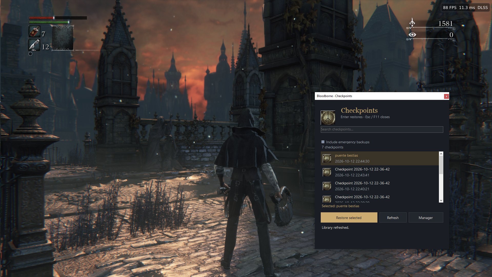
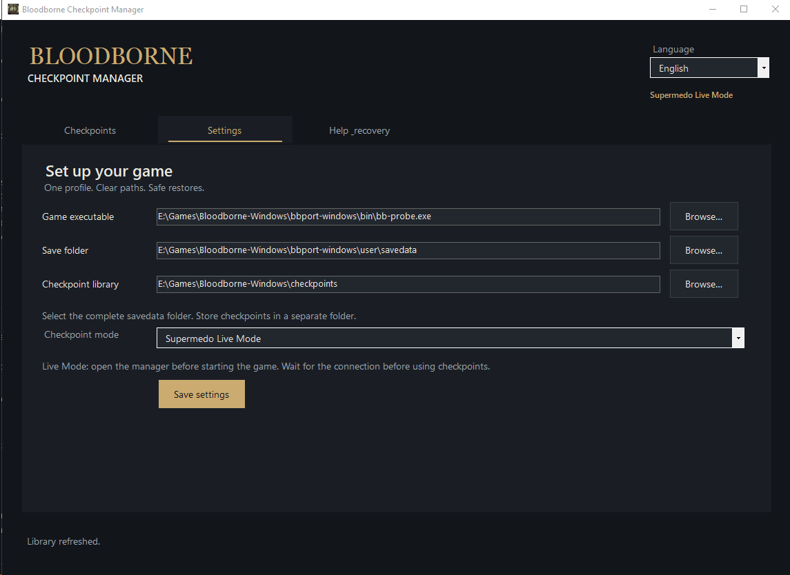
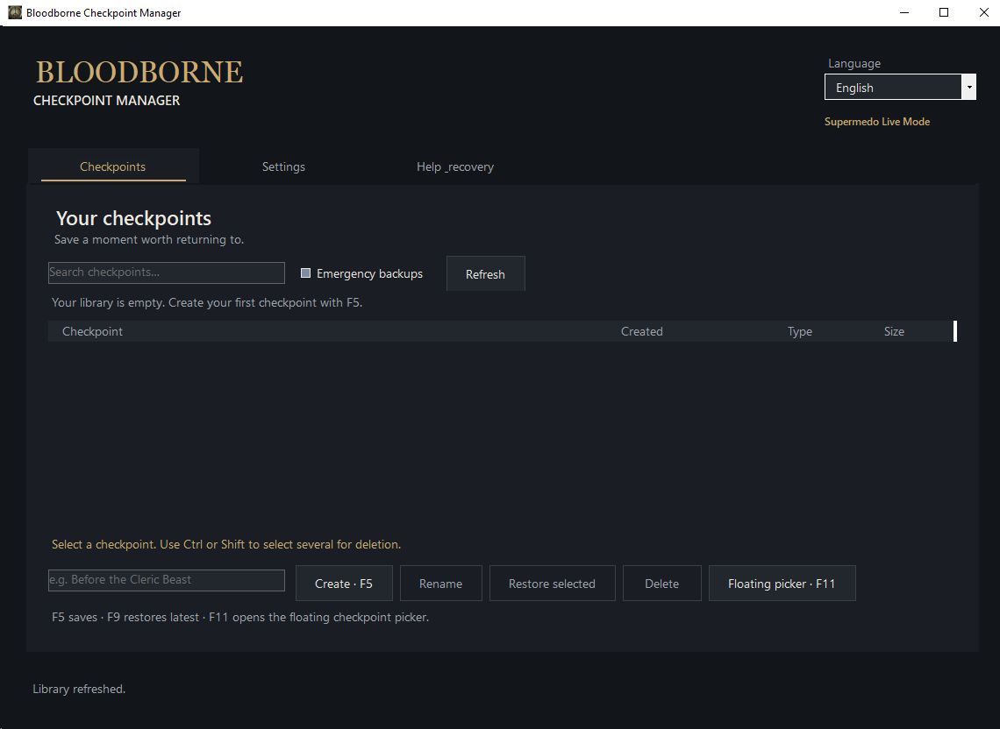

# Bloodborne Checkpoint Manager

Create checkpoints of your save and return to them whenever you want to retry a fight or recover your saved progress and consumables.

Works with [Supermedo](https://github.com/Supermedo/bloodborne_pc) and [Awaken / BloodBorneButPc](https://github.com/Awakenchan/BloodBorneButPc), on Windows x64 in single-player mode. Some port updates may require a manager update.

Supermedo 1.8.2 and Awaken 0.9.33. Awaken support remains experimental; see [Awaken support](docs/AWAKEN.md) for its current limits.

## Getting started

Download the `-windows.zip` package from [Releases](https://github.com/santiagovalencia109/BloodborneCheckpointManager/releases). You need the .NET Desktop Runtime 8 x64. Extract the entire package and open `BloodborneCheckpointManager.exe`.

In **Settings**:

1. Choose your **Game port** first. Each port keeps its own settings.
2. Select the native `bb-probe.exe`, not the launcher. Awaken packages use `engine/out/bb-probe.exe`.
3. Select the complete `savedata` folder used by your current player profile.
4. Choose a separate checkpoint folder for this port.
5. Select **Supermedo Live Mode** or **Awaken Live Mode**, then save your settings.

Use **Closed Game Mode** if you want to manage checkpoints with the game closed.

**Live Mode requires the manager to be open before you start the game.** Launch the game from your usual launcher, then wait for the manager to confirm the connection. If the game was already running, close it normally and start it again with the manager open.

## Playing

| Key | Action |
| --- | --- |
| **F5** | Create a checkpoint. |
| **F9** | Restore the latest manual checkpoint. |
| **F11** | Open the picker to restore a specific checkpoint. |

Restoring returns the game to the title screen. **Wait for “Checkpoint restored” before selecting Continue.**

You can also create, restore, rename and delete checkpoints from the manager window. Hold **Ctrl** or **Shift** to select several checkpoints, then choose **Delete** to remove them together. **Ctrl+A** selects all checkpoints currently shown. If a shortcut is marked as occupied, close other manager windows or apps using that key. The manager will reclaim it when it becomes available.

## Keep in mind

- Checkpoints restore what the game writes to its save files. Your position may not match the exact moment you pressed F5.
- Before restoring, the manager makes an emergency backup of your current save.
- If a restore is interrupted, close the game and follow the [recovery instructions](docs/FLOATING_PICKER.md#settings-explained).

Change the interface language under **Language**. To add a translation, see the [translation guide](docs/TRANSLATING.md).

See the documentation for [build instructions](docs/EXTERNAL_BRIDGE_USAGE.md#build) and [compatibility details](docs/ADAPTIVE_DETECTION.md).

## Source code

Open `BloodborneCheckpointManager.sln` in Visual Studio, or use the .NET SDK. The application is in `src/`, the native bridge in `native/`, and tests in `tests/`.

The `-windows.zip` package contains the ready-to-run app. The `-source.zip` package contains the project. Both are available in [Releases](https://github.com/santiagovalencia109/BloodborneCheckpointManager/releases). Local builds go in `artifacts/`, which is excluded from Git. See [project layout](docs/PROJECT_LAYOUT.md) for the folder structure.
